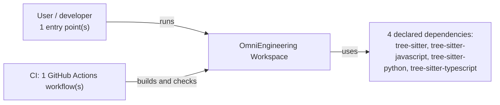
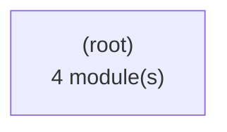
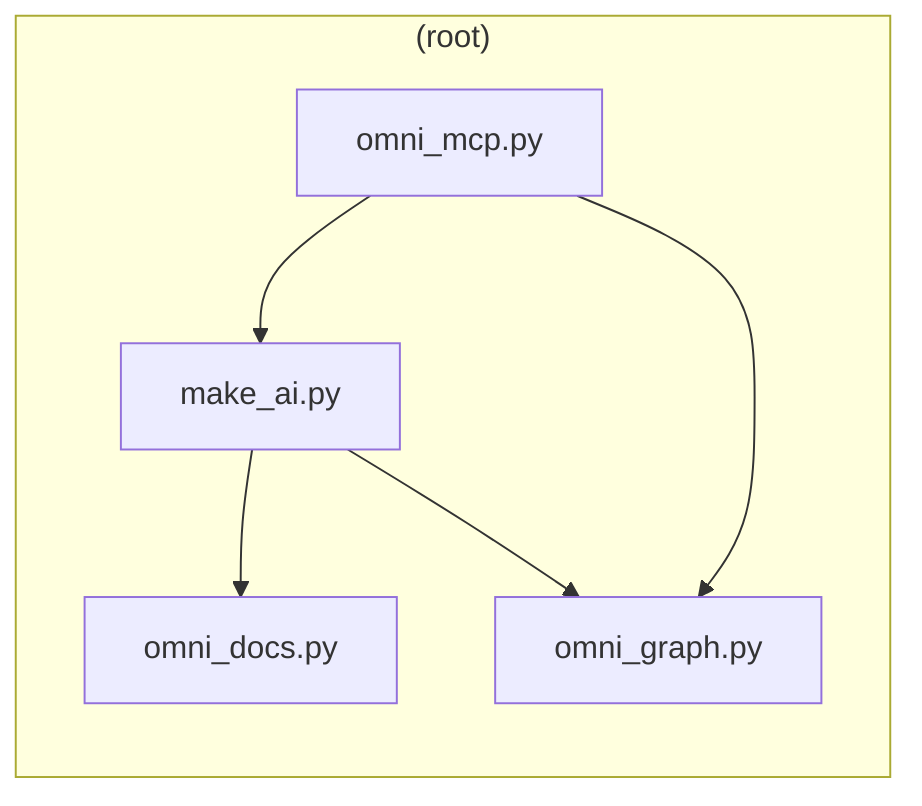
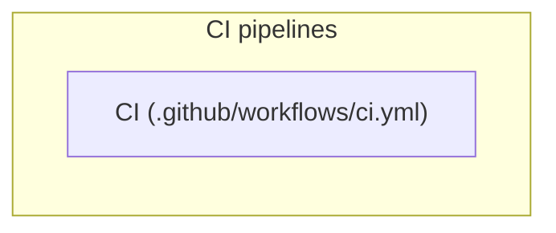

# Software Architecture Document (SAD)

<!-- Generated by `omni docs build` (REQ-060) for OmniEngineering Workspace. Do not edit; regenerate. -->

Structured after arc42 and ISO/IEC/IEEE 42010. Every view is derived from the code graph, the requirement registry, the failure ledger and files on disk; a view with no data behind it says so.

## 1. Introduction and goals

**System:** OmniEngineering Workspace

OmniEngineering is a repo-local software engineering workspace for human and AI engineering teams. Its goal is bigger than prompt sharing: it gives a project a durable way to carry requirements, engineering rules, delivery workflows, quality gates, design knowledge, and assistant context together.

All 60 registered requirements are completed or withdrawn; no open high-priority goal is recorded.

## 2. Constraints

- Python >=3.10 (pyproject.toml `requires-python`).
- Languages in the code graph: python (34 modules).
- Project policy: `allow_broad_refactor`, `allow_dependency_changes`, `allow_schema_changes`, `allow_destructive_data_changes` are false, so such changes need explicit approval.

## 3. System context

- Actors and external systems come only from entry points, declared dependencies and CI files.

Entry points:

- console script `omni` -> make_ai:main

## 4. Building-block view

### 4.1 Containers (level 1)

- Edge labels count module-level imports between containers.

### 4.2 Components (level 2)

- Arrows point from the importing module to the imported one; labels count imports when more than one.
- 30 test module(s) are left out; see the test plan.

Per-module detail is in the [Software Design Document (SDD)](design.md) and the [Module Reference](modules.md).

## 5. Runtime view

**console script `omni` -> make_ai:main**

```mermaid
flowchart TD
    f_make_ai_py_main["main"]
    f_make_ai_py_build_parser["build_parser"]
    f_make_ai_py_docs_regeneration_wanted["docs_regeneration_wanted"]
    f_make_ai_py_regenerate_docs_after_requirement_change["regenerate_docs_after_requirement_change"]
    f_make_ai_py_run_adopt["run_adopt"]
    f_make_ai_py_run_arbiter_baseline["run_arbiter_baseline"]
    f_make_ai_py_run_arbiter_install["run_arbiter_install"]
    f_make_ai_py_run_arbiter_sync["run_arbiter_sync"]
    f_make_ai_py_run_arbiter_update["run_arbiter_update"]
    f_make_ai_py_run_context["run_context"]
    f_make_ai_py_run_docs_build["run_docs_build"]
    f_make_ai_py_run_doctor["run_doctor"]
    f_make_ai_py_run_gate["run_gate"]
    f_make_ai_py_run_graph_benchmark["run_graph_benchmark"]
    f_make_ai_py_main --> f_make_ai_py_build_parser
    f_make_ai_py_main --> f_make_ai_py_docs_regeneration_wanted
    f_make_ai_py_main --> f_make_ai_py_regenerate_docs_after_requirement_change
    f_make_ai_py_main --> f_make_ai_py_run_adopt
    f_make_ai_py_main --> f_make_ai_py_run_arbiter_baseline
    f_make_ai_py_main --> f_make_ai_py_run_arbiter_install
    f_make_ai_py_main --> f_make_ai_py_run_arbiter_sync
    f_make_ai_py_main --> f_make_ai_py_run_arbiter_update
    f_make_ai_py_main --> f_make_ai_py_run_context
    f_make_ai_py_main --> f_make_ai_py_run_docs_build
    f_make_ai_py_main --> f_make_ai_py_run_doctor
    f_make_ai_py_main --> f_make_ai_py_run_gate
    f_make_ai_py_main --> f_make_ai_py_run_graph_benchmark
```

- Static direct calls only (same-module, enclosing-class or import-resolved); call order and conditions are not shown.
- 62 further call(s) omitted at the 14-node cap.

## 6. Deployment view

- Nodes are grouped by descriptor type; how they connect at run time is not derived (no edges are drawn).

## 7. Cross-cutting concepts

External modules imported by three or more source modules: `json` (4), `pathlib` (4), `typing` (4), `os` (3), `re` (3), `subprocess` (3).

Engineering rulepacks that apply across the codebase (`.ai/rules`):

- `completion-workflow`: Define the gates required before an AI-assisted task can be reported complete.
- `controlled-implementation`: Keep implementation work scoped, traceable, conservative, and maintainable.
- `data-governance`: Bound data-related work across contracts, validation, transformations, privacy, persistence, migrations, and testing.
- `fallback-llm-rules`: Provide a compact operating contract when an assistant cannot access or fails to follow the full .ai configuration.
- `hci-ui-rules`: Keep user-facing changes clear, usable, accessible, responsive, and consistent with the existing product experience.
- `oop-design`: Keep domain modeling, module boundaries, interfaces, and dependency direction maintainable.

## 8. Architecture decisions

Decision records and design documents in the repository:

- [design/README.md](../../design/README.md): OmniEngineering Design Documents
- [design/assistant-workflow.md](../../design/assistant-workflow.md): Assistant Workflow
- [design/cli-design.md](../../design/cli-design.md): CLI Design
- [design/data-model.md](../../design/data-model.md): Data Model
- [design/decision-records.md](../../design/decision-records.md): Decision Records
- [design/product-design.md](../../design/product-design.md): Product Design
- [design/system-architecture.md](../../design/system-architecture.md): System Architecture
- [design/validation-and-operations.md](../../design/validation-and-operations.md): Validation And Operations

## 9. Quality requirements

7 requirement(s) name a quality attribute in their category or title (CLI / template maintainability 6, Process 1); 0 still open. Each is a row in the [Software Requirements Specification (SRS)](requirements.md).

## 10. Risks and technical debt

0 open failure(s) of 19 in the failure ledger.

1 recorded failure(s) recurred after an earlier fix (technical debt that came back): FAIL-018 repeats FAIL-017.

No open requirement carries a risk note.

## 11. Glossary

Terms defined in code (public classes with a docstring):

| Term | Meaning | Defined in |
| --- | --- | --- |
| GraphDependencyError | tree-sitter or a language grammar package is not installed. | `omni_graph.py` |
| Ids | Stable, collision-free Mermaid identifiers: [A-Za-z][A-Za-z0-9_]*, never a keyword. | `omni_docs.py` |
| ToolError | A well-formed refusal (not found, ambiguous, missing graph) -- reported to the client, not a crash. | `omni_mcp.py` |
