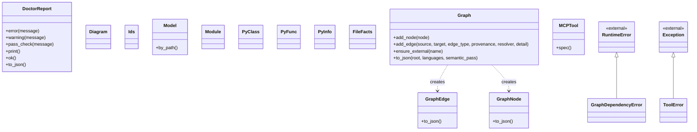

# Class Diagram

<!-- Generated by `omni docs build` (REQ-060) for OmniEngineering Workspace. Do not edit; regenerate. -->

15 class(es) in the code graph; per-package diagrams are in the [Software Design Document (SDD)](design.md).

- `<|--` is inheritance; `..> creates` means a method of the first class instantiates the second (resolved call edge). Attribute composition is not in the graph and is not drawn.
