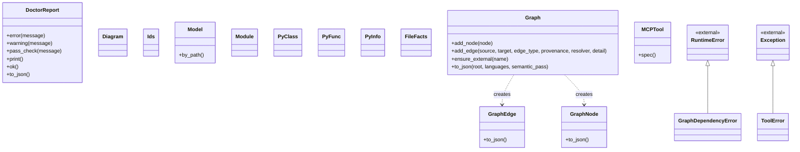

# Software Design Document (SDD)

<!-- Generated by `omni docs build` (REQ-060) for OmniEngineering Workspace. Do not edit; regenerate. -->

Organised after IEEE 1016: for each module, its purpose, interfaces, data structures, dependencies and the design rationale a docstring or requirement records. Interfaces are read from the source with Python's `ast`; dependencies come from the code graph.

## Package (root)

Classes in this package:

- `<|--` is inheritance; `..> creates` means a method of the first class instantiates the second (resolved call edge). Attribute composition is not in the graph and is not drawn.

### Module make_ai.py

Source: [make_ai.py](../../make_ai.py)

**Purpose.** _Not derived: no module docstring._

**Interfaces.**

- `render_assistant_pointer(file_path: str, source_path: str) -> str`
- `assistant_pointers() -> dict[str, str]`
- `read_json(path: Path, report: DoctorReport) -> Any`
- `load_json(path: Path) -> Any`
- `write_json(path: Path, value: Any) -> None`
- `git_current_ref(repo_root: Path) -> str | None`
- `git_show_file(repo_root: Path, ref: str, relative_path: str) -> str | None`
- `three_way_merge(ours: str, base: str, theirs: str) -> tuple[str, bool]`: Merge via `git merge-file` (ships with git, no extra dependency).
- `write_omni_version_file(source_root: Path, target_root: Path) -> None`: Record the template source and ref. Keys this function does not own (such as the `arbiter` block `record_arbiter_version` writes) are read back and kept.
- `read_omni_version_file(target_root: Path=Path('.')) -> dict[str, Any] | None`
- `read_ignore_patterns(paths: list[Path] | None=None) -> list[str]`
- `path_matches_pattern(path: Path, pattern: str, is_dir: bool) -> bool`
- `should_skip_map_path(path: Path, is_dir: bool, ignore_patterns: list[str], include_ai: bool) -> bool`
- `split_csv(value: str | None) -> list[str]`
- `slugify(value: str) -> str`
- `next_requirement_id(requirements: dict[str, Any]) -> str`
- `resolve_rulepack_path(rulepack: str) -> Path`
- `verify_required_ai_files(report: DoctorReport) -> None`
- `validate_json_files(report: DoctorReport) -> dict[str, Any]`
- `validate_ruleset(ruleset: Any, report: DoctorReport) -> None`
- `requirement_shape_problems(requirement: dict[str, Any]) -> list[str]`
- `check_requirement_entries(items: list[Any], label: str, report: DoctorReport, seen_ids: set[str]) -> None`
- `validate_requirements(requirements: Any, report: DoctorReport) -> None`
- `validate_requirement_ids(report: DoctorReport) -> None`: One id names one requirement, across the root registry, its archive and every vendored workspace's registries. A pair inside the root registry or its archive is already reported by validate_require...
- `validate_requirement_aliases(report: DoctorReport) -> None`: Every `id_aliases` entry must point at a requirement that exists (registry or archive), and no alias key may still be a live id: one id names one requirement, so it cannot be both an alias and an e...
- `validate_failure_ledger(ledger: Any, report: DoctorReport) -> None`
- `validate_test_suites(config: Any, report: DoctorReport) -> None`
- `validate_graph_config(report: DoctorReport) -> None`
- `validate_rulepacks(parsed: dict[str, Any], report: DoctorReport) -> None`
- `manifest_paths(value: Any) -> list[str]`
- `validate_context_manifest(manifest: Any, report: DoctorReport) -> None`
- `validate_assistant_pointers(report: DoctorReport) -> None`
- `validate_entrypoint_sources(report: DoctorReport) -> None`
- `validate_synced_ignore_files(report: DoctorReport) -> None`
- `validate_workspace_placement(report: DoctorReport) -> None`
- `validate_markdown_assets(report: DoctorReport) -> None`
- `validate_project_map(report: DoctorReport) -> None`
- `validate_project_map_freshness(report: DoctorReport) -> None`
- `validate_project_graph(report: DoctorReport) -> None`
- `validate_recent_commits_tracked(report: DoctorReport) -> None`
- ... and 163 more public functions.

**Data structures.**

- `class DoctorReport`
  - `__init__(self) -> None`
  - `error(self, message: str) -> None`
  - `warning(self, message: str) -> None`
  - `pass_check(self, message: str) -> None`
  - `print(self) -> None`
  - `ok(self) -> bool`
  - `to_json(self) -> dict[str, Any]`: The `--json` shape. `schema_version` 2 (REQ-046): `posture.arbiter` carries `wired`, `full` and `gate`; keys are only ever added. The schema 1 top-level keys under `posture.arbiter` (`present`, `fr...

**Dependencies.**

- Imports: `omni_docs.py`, `omni_graph.py`
- Imported by: `omni_mcp.py`
- External: `argparse`, `datetime`, `fnmatch`, `hashlib`, `json`, `os`, `pathlib`, `queue`, `re`, `shlex`, `shutil`, `subprocess`, `sys`, `tempfile`, `threading`, `time`, `typing`

**Design rationale.**

Requirements scoped to this module: REQ-001 (Add universal engineering ruleset), REQ-003 (Add OmniContext doctor and requirement registry), REQ-004 (Centralize fallback rules for LLM entrypoints), REQ-005 (Clarify OmniContext purpose and make_ai role), REQ-006 (Replace Python data rules with data governance rules), REQ-007 (Convert enforceable rule files to JSON), REQ-008 (Add low-friction rule and requirement editing), REQ-009 (Add omni command entrypoint), REQ-010 (Remove tomllib dependency), REQ-011 (Add project-map freshness and changelog-drift checks to omni doctor), and 40 more.

### Module omni_docs.py

Source: [omni_docs.py](../../omni_docs.py)

**Purpose.** REQ-060: `omni docs build` -- standard engineering documents and Mermaid diagrams, generated without a model.

**Interfaces.**

- `parse_python(path: Path) -> PyInfo | None`
- `load_model(root: Path, graph_path: Path | None, out_dir: Path) -> Model`
- `cell(value: Any) -> str`
- `code(value: Any) -> str`
- `mlabel(value: Any) -> str`: A Mermaid label safe inside double quotes.
- `mermaid(lines: list[str]) -> list[str]`
- `not_derived(reason: str) -> str`
- `link(model: Model, relpath: str, text: str | None=None) -> str`
- `header(model: Model, filename: str, title: str) -> list[str]`
- `finish(lines: list[str]) -> str`
- `code_modules(model: Model) -> list[Module]`
- `internal_imports(model: Model) -> set[tuple[str, str]]`: (importer, imported) module paths inside the project: the graph's import edges plus imports guarded by `try`/`if`, which the graph does not record.
- `external_imports(model: Model) -> dict[str, set[str]]`: module path -> names of external modules it imports.
- `module_of_node(model: Model, node_id: str) -> str | None`
- `requirements_for(model: Model, path: str) -> list[dict[str, Any]]`
- `declared_dependencies(root: Path) -> list[str]`: Package names declared in pyproject.toml, requirements*.txt and package.json (names only).
- `deployment_descriptors(root: Path) -> list[str]`
- `compose_services(text: str) -> list[str]`
- `entry_points(model: Model) -> list[tuple[str, str]]`: (label, function node id or "") for console scripts, then `if __name__ == "__main__"` modules of the project (embedded tooling excluded). One entry per function: a console script wins over the modu...
- `summarize_entries(entries: list[tuple[str, str]], limit: int=8) -> list[str]`
- `container_diagram(model: Model) -> Diagram | None`
- `component_diagram(model: Model) -> Diagram | None`
- `context_diagram(model: Model) -> Diagram`
- `class_relations(model: Model, class_ids: set[str] | None=None) -> tuple[list[tuple[str, str]], list[tuple[str, str]], list[tuple[str, str]]]`: (internal inherits, external inherits as (class id, base name), creates) among non-test, non-tooling classes.
- `class_diagram(model: Model, candidates: list[str], cap: int) -> Diagram | None`
- `runtime_flow(model: Model, entry_id: str) -> tuple[Diagram | None, str]`: A depth-2 static call flow from an entry function, using only confidently resolved call edges.
- `emit(diagram: Diagram) -> list[str]`
- `active_requirements(model: Model) -> list[dict[str, Any]]`
- `failures_for(model: Model, req_id: str) -> list[dict[str, Any]]`
- `linked_tests(model: Model, req: dict[str, Any]) -> list[str]`: Tests tied to a requirement by real data: test paths in its scope, test files changed by the commits that deliver it, regression tests of its failures, and test modules the graph says verify a modu...
- `commit_files_for(model: Model, req_id: str) -> tuple[int, set[str]]`
- `resolve_doc(model: Model, entry: str) -> str | None`
- `section(title: str, level: int=2) -> list[str]`
- `render_architecture(model: Model) -> str`
- `render_design(model: Model) -> str`
- `render_modules(model: Model) -> str`
- `render_class_diagram(model: Model) -> str`
- `render_requirements(model: Model) -> str`
- `render_traceability(model: Model) -> str`
- `render_test_plan(model: Model) -> str`
- ... and 5 more public functions.

**Data structures.**

- `class PyFunc`
- `class PyClass`
- `class PyInfo`
- `class Module`
- `class Model`
  - `by_path(self) -> dict[str, Module]`
- `class Ids`: Stable, collision-free Mermaid identifiers: [A-Za-z][A-Za-z0-9_]*, never a keyword.
  - `__init__(self, prefix: str) -> None`
- `class Diagram`

**Dependencies.**

- Imports: no project modules.
- Imported by: `make_ai.py`
- External: `ast`, `dataclasses`, `json`, `os`, `pathlib`, `re`, `subprocess`, `typing`

**Design rationale.**

Every document is derived from data the workspace already keeps: the code graph (`.ai/project-graph.json`), the requirement registry, the failure ledger, the test-suite registry, git history (as recorded in the graph's history layer), Python docstrings and signatures read with `ast`, and deployment descriptors found on disk. A section with no data behind it says "Not derived: ..." instead of in...

Requirements scoped to this module: REQ-060 (omni docs build: generated engineering docs and diagrams).

### Module omni_graph.py

Source: [omni_graph.py](../../omni_graph.py)

**Purpose.** Deterministic, local source-code graph built from tree-sitter ASTs.

**Interfaces.**

- `normalise_cwe(value: Any) -> list[str]`: `"CWE-89"`, `89`, `"cwe_89"`, `["CWE-79", ...]` -> `["CWE-89", ...]`, deduplicated, order kept.
- `graph_config(root: Path, problems: list[str] | None=None) -> dict[str, Any]`: The project's graph settings: defaults overlaid with .ai/graph-config.json. Never raises.
- `discover_source_files(root: Path, languages: list[str]) -> list[tuple[Path, str]]`
- `load_language(language: str)`
- `parse_python_file(path: Path, root: Path, source: bytes, graph: Graph) -> FileFacts`
- `parse_js_like_file(path: Path, root: Path, source: bytes, graph: Graph, language: str) -> FileFacts`
- `run_semantic_pass(graph: Graph, max_nodes: int=SEMANTIC_MAX_NODES_DEFAULT) -> dict[str, Any]`
- `language_extensions() -> dict[str, tuple[str, ...]]`
- `parse_generic_file(path: Path, root: Path, source: bytes, graph: Graph, language: str) -> FileFacts`
- `parse_sql_migrations(files: list[tuple[Path, str]], graph: Graph) -> dict[str, int]`
- `build_graph(root: Path, languages: list[str], semantic: bool=False, layers: set[str] | None=None, max_commits: int | None=None) -> tuple[Graph, dict[str, Any]]`
- `build_inputs(root: Path, cfg: dict[str, Any] | None=None) -> dict[str, Any]`: ARB-064: the cheap-to-stat inputs a rebuild would react to: HEAD, the Arbiter report(s) the findings come from, the requirement registries, the failure ledger, the test-suite file and the graph con...
- `graph_stale(graph_path: Path, root: Path) -> tuple[bool, str]`: ARB-064: whether the graph file predates its inputs. (True, reason) when a rebuild is due, (False, "") when the recorded inputs match what is on disk now; a graph written before inputs were recorde...
- `is_test_path(relpath: str | None, extra: Any=(), exclude: Any=()) -> bool`: True for files that hold tests, judged by directory and file-name conventions.
- `vendored_workspaces(root: Path) -> list[str]`: Relative posix paths of the vendored workspaces below `root` (one or two levels down), never the root itself.
- `parse_changelog(text: str) -> list[dict[str, Any]]`: Split a changelog into entries. Handles `## 2026-09-01 (2) (Title)`, Keep a Changelog `## [1.2.0] - 2024-01-01`, `## v1.2.0 (2024-01-01)` and `# 2024-01-01`: the entry level is the largest heading...
- `vendored_changelogs(root: Path) -> list[tuple[str, str]]`: REQ-054: (workspace, changelog path) for every vendored workspace that keeps a CHANGELOG.md.
- `add_governance_layer(graph: Graph, root: Path) -> dict[str, Any]`: Requirements and changelog entries, linked to the files they declare or name.
- `is_tooling_path(relpath: str | None, root: Path) -> bool`
- `mark_tooling_nodes(graph: Graph, root: Path) -> int`: Move OmniEngineering's own code (make_ai.py, omni_graph.py, ...) out of the project's code layer.
- `add_workspace_layer(graph: Graph, root: Path) -> dict[str, Any]`: OmniEngineering itself as embedded in the project: rulepacks, their rules, playbooks and checklists.
- `add_history_layer(graph: Graph, root: Path, max_commits: int=DEFAULT_MAX_COMMITS) -> dict[str, Any]`: The git log as a layer: every commit, the changelog entries it wrote, the requirements it delivered, the files it changed.
- `mark_test_nodes(graph: Graph, extra_files: set[str] | None=None, test_globs: Any=(), exclude_globs: Any=()) -> set[str]`: Move nodes that live in test files (by name, or registered/detected as a suite file) to the assurance layer.
- `derive_verifies(graph: Graph, test_ids: set[str]) -> int`: `verifies` edges: test file -> the code it calls, imports or extends (derived from EXTRACTED edges).
- `load_failure_ledger(root: Path, problems: list[str] | None=None) -> dict[str, Any] | None`
- `add_assurance_layer(graph: Graph, root: Path) -> dict[str, Any]`: Tests, the failure ledger with its reasoning, and the rules those failures produced.
- `check_failure_ledger(root: Path) -> dict[str, Any]`: Structural and referential problems in the failure ledger, for `omni failure check` and doctor.
- `find_findings_reports(root: Path, cfg: dict[str, Any] | None=None) -> list[Path]`: The reports the finding nodes come from, oldest-precedence first (ARB-064).
- `find_findings_report(root: Path, cfg: dict[str, Any] | None=None) -> Path | None`: The newest report the finding nodes come from (the gate report when there is one), or None.
- `load_findings(root: Path, report: Path, problems: list[str] | None=None) -> list[dict[str, Any]]`: The unsuppressed findings of an Arbiter report, reduced to the fields the graph keeps (never the evidence): id, rule_id, probe, dimension, severity, status, tags, cwe, controls, title, path (graph-...
- `load_merged_findings(root: Path, reports: list[Path], problems: list[str] | None=None) -> list[dict[str, Any]]`: ARB-064: the findings of several reports merged by id. The first report is the base; a later one adds the ids it alone holds and, when it is at least as new as the base, overrides `status` for the...
- `changelog_bullets(text: str) -> list[tuple[int, int, str]]`: (first line, last line, text) of every top-level bullet in a change log; indented lines and sub-bullets belong to the bullet above them, a heading or a fenced block's end closes it.
- `trace_rules_to_requirements(graph: Graph, root: Path, stats: dict[str, Any] | None=None) -> dict[str, int]`: REQ-054: `specified_by` edges from the report's own `requirements` (EXTRACTED), then from the change logs (the root's and every vendored workspace's, with `mentions_rule`), the registries and the r...
- `blame_lines(root: Path, relpath: str, lines: list[int], commit: str | None=None) -> dict[int, str] | None`: One `git blame --porcelain` for a file: the full hash each of `lines` came from, "" for a line git holds as uncommitted. `commit` None blames the working tree. None when git cannot blame the file a...
- `describe_findings_source(root: Path, cfg: dict[str, Any] | None=None) -> dict[str, Any]`: What `omni graph sources` reports for the findings: which report(s) would be read, how many findings they hold after the merge, or why none.
- `load_test_suites(root: Path, problems: list[str] | None=None) -> dict[str, Any] | None`
- `detect_test_framework(root: Path, relpath: str) -> str | None`: Name the test framework a file uses from what it imports and declares, or None if it shows no signal.
- `detect_test_suites(root: Path, source_files: list[str]) -> list[dict[str, Any]]`: Find test files by name and by what they contain, group them by project and framework, and attach CI commands.
- `resolve_test_suites(root: Path, source_files: list[str]) -> dict[str, Any]`: Manual suites (authoritative) merged with auto-detected ones that add files no manual suite claimed.
- `check_test_suites(root: Path, source_files: list[str]) -> dict[str, Any]`: Problems with the manual registry (errors) and detected tests nothing registered (a notice).
- ... and 23 more public functions.

**Data structures.**

- `class GraphDependencyError(RuntimeError)`: tree-sitter or a language grammar package is not installed.
- `class GraphNode`
  - `to_json(self) -> dict[str, Any]`
- `class GraphEdge`
  - `to_json(self) -> dict[str, Any]`
- `class Graph`
  - `__init__(self) -> None`
  - `add_node(self, node: GraphNode) -> GraphNode`
  - `add_edge(self, source: str, target: str, edge_type: str, provenance: str, resolver: str, detail: str='') -> None`
  - `ensure_external(self, name: str) -> GraphNode`
  - `to_json(self, root: str, languages: list[str], semantic_pass: dict[str, Any]) -> dict[str, Any]`
- `class FileFacts`

**Dependencies.**

- Imports: no project modules.
- Imported by: `make_ai.py`, `omni_mcp.py`
- External: `collections`, `dataclasses`, `datetime`, `fnmatch`, `html`, `json`, `math`, `os`, `pathlib`, `random`, `re`, `shlex`, `subprocess`, `textwrap`, `typing`, `urllib`

**Design rationale.**

This is not a vector index: there are no embeddings and nothing is stored as a similarity score. Every node is a code entity read directly out of a syntax tree (a module, class, function, or method) and every edge is tagged with where it came from:

Requirements scoped to this module: REQ-015 (Add omni graph: a deterministic tree-sitter AST code graph, not a vector index), REQ-019 (Add omni graph render: a permanent, stdlib-only SVG visualization command), REQ-021 (omni graph show --all and an offline interactive 3D graph viewer (omni graph view)), REQ-022 (Five-layer code graph (code, governance, history, assurance, workspace) with a failure ledger, project-focused test suites, and configuration that works for any project), REQ-023 (Graph viewer: real 2D view (no GPU), views instead of layers, chain highlight, path tracing, better search, collapsible menus, tooltips, light theme), REQ-024 (Lineage: pick any node and trace up and down with no second endpoint (CLI and viewer)), REQ-029 (omni graph benchmark: measure the token-savings claim instead of just asserting it), REQ-030 (Fix CI: graph build needs tree-sitter for every language, python included -- no ast fallback exists), REQ-039 (omni graph impact: changed files to requirements, tests, failures and rules), REQ-043 (Arbiter findings are graph nodes, traceable by id, category, severity, depth and directory, interactively), and 5 more.

### Module omni_mcp.py

Source: [omni_mcp.py](../../omni_mcp.py)

**Purpose.** A minimal MCP (Model Context Protocol) server over stdio, exposing the graph and registries as tools.

**Interfaces.**

- `dispatch(name: str, arguments: dict[str, Any] | None) -> Any`
- `handle_message(message: dict[str, Any]) -> dict[str, Any] | None`: One JSON-RPC request in, one response out (or None for a notification, which gets none).
- `serve_stdio(input_stream: TextIO | None=None, output_stream: TextIO | None=None) -> None`: The stdio transport: one JSON object per line in, one per line out. Runs until stdin closes.

**Data structures.**

- `class MCPTool`
  - `__init__(self, name: str, description: str, input_schema: dict[str, Any], handler: Callable[[dict[str, Any]], Any]) -> None`
  - `spec(self) -> dict[str, Any]`
- `class ToolError(Exception)`: A well-formed refusal (not found, ambiguous, missing graph) -- reported to the client, not a crash.

**Dependencies.**

- Imports: `make_ai.py`, `omni_graph.py`
- Imported by: no project modules.
- External: `json`, `pathlib`, `sys`, `traceback`, `typing`

**Design rationale.**

`omni graph why/lineage/trace/...` and `omni requirement/failure show/list/search` already return plain JSON (`--json`); this is the same data, reachable without shelling out to the CLI and parsing its output, so any MCP-speaking assistant -- not only the one with a shell tool, and not only Claude -- can query this project's requirements, changelog, commits, tests and failures the same way `omn...

Requirements scoped to this module: REQ-027 (MCP server: the graph and registries as tools for any assistant, not only Claude), REQ-028 (Make declared rule validations real: a dead check fixed, one new honest safety net added), REQ-039 (omni graph impact: changed files to requirements, tests, failures and rules), REQ-043 (Arbiter findings are graph nodes, traceable by id, category, severity, depth and directory, interactively), REQ-053 (Arbiter Phase 1 pulled in: rule packs for all five languages, and every finding traceable to its rule and CWE in the graph), REQ-057 (Documentation matches the CLI and code).
